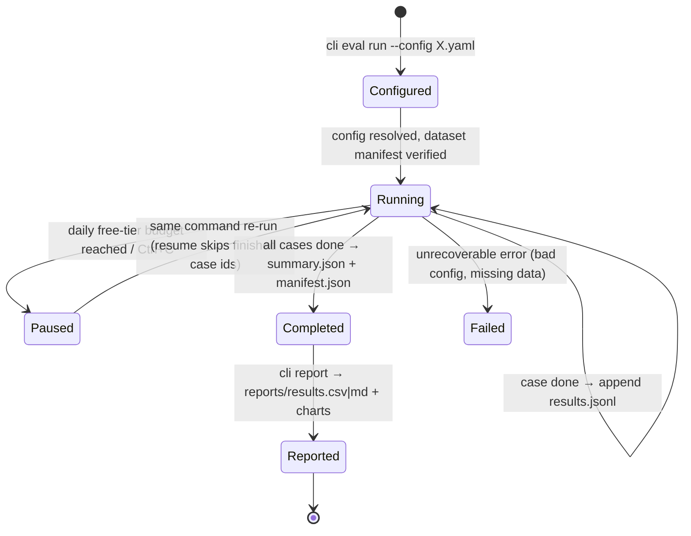
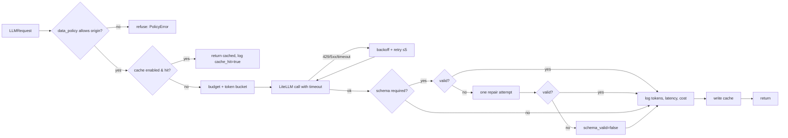

# Application Flow — Prompt-Injection Detector Benchmark

> Four prompt-injection detectors compared on catching attacks without blocking normal users — plus a published set of tricky benign prompts.

Project documentation: [PRD.md](PRD.md) · [TRD.md](TRD.md) · **APPFLOW.md** · [UI_UX_DESIGN.md](UI_UX_DESIGN.md) · [BACKEND_SCHEMA.md](BACKEND_SCHEMA.md) · [IMPLEMENTATION_PLAN.md](IMPLEMENTATION_PLAN.md) · [WORKLOG.md](WORKLOG.md) · [IMPLEMENTATION_PROMPTS.md](IMPLEMENTATION_PROMPTS.md) · [CLAUDE.md](CLAUDE.md) · [PROMPT_PLAYBOOK.md](PROMPT_PLAYBOOK.md)

| Field | Value |
|---|---|
| Project | P03 · `03-prompt-injection-detectors` |
| Type | Quick win 3 of 3 |
| Skill it adds | AI security, guardrails |
| Target role signal | AI/GenAI Engineer · LLM security · guardrails · evaluation rigour |
| Effort | ≈ 3.75 focused days (sum of task estimates; the ideas doc says 2–3 days) |
| Public artefact | Hugging Face Space + fine-tuned model + hard-negative dataset on the HF Hub |
| Interface | Gradio 5 → Hugging Face Space |
| Status | Specification v2.1 (lean, local-first build) · 2026-10-23 |

---

## 1. User journeys

### J1 — Recruiter
Space **Results** → "At a [Y]% false-positive rate, the fine-tuned model catches [X]% of attacks" →
recall-vs-FPR chart → **Try it**: pastes "what does 'system prompt' mean?" → four verdicts; three say
benign, one flags it, with its reason.

### J2 — Developer reproduces
`cli data prepare` → `cli hn validate` → `cli eval run` for A, B, D → Kaggle notebook (human) →
`cli import-predictions` → `cli sweep c` → `cli report`.

## 2. System flow — Try it

```mermaid
sequenceDiagram
    participant UI
    participant S as Bench service
    UI->>S: text (≤ 2,000 chars)
    par
        S->>S: A rules, B Prompt Guard, C classifier (CPU)
    and
        S->>S: D judge (Ollama locally; Groq on the Space)
    end
    S-->>UI: 4 × {verdict, score, latency_ms, evidence}
```

The pasted text is only ever *classified*. It is never executed, forwarded to a tool-using agent, or
logged.

## 3. States

| State | UI |
|---|---|
| all benign | green "No detector flagged this" |
| split verdict | neutral "Detectors disagree" + who flagged |
| all flagged | red "All detectors flagged this" |
| LLM judge paused (Space budget / Ollama not running) | amber on the D column only |

---

## S1. Evaluation run lifecycle (shared)



Kaggle variants join at `Completed` through `cli import-predictions`.

## S2. LLM call flow (shared)



## S3. Results viewing (shared)

1. `cli report` writes `reports/results.csv` (one row per variant × subset) and `reports/*.png`.
2. The Space's results tab reads those committed files — no live recomputation, no database.
3. The failures tab reads `reports/failures.csv` (hand-labelled `failure_label`, `note`).
