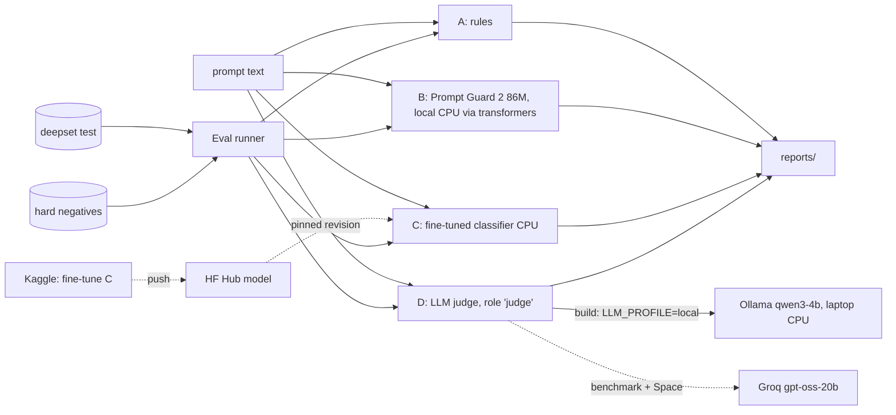

# Technical Requirements Document — Prompt-Injection Detector Benchmark

> Four prompt-injection detectors compared on catching attacks without blocking normal users — plus a published set of tricky benign prompts.

Project documentation: [PRD.md](PRD.md) · **TRD.md** · [APPFLOW.md](APPFLOW.md) · [UI_UX_DESIGN.md](UI_UX_DESIGN.md) · [BACKEND_SCHEMA.md](BACKEND_SCHEMA.md) · [IMPLEMENTATION_PLAN.md](IMPLEMENTATION_PLAN.md) · [WORKLOG.md](WORKLOG.md) · [IMPLEMENTATION_PROMPTS.md](IMPLEMENTATION_PROMPTS.md) · [CLAUDE.md](CLAUDE.md) · [PROMPT_PLAYBOOK.md](PROMPT_PLAYBOOK.md)

| Field | Value |
|---|---|
| Project | P03 · `03-prompt-injection-detectors` |
| Type | Quick win 3 of 3 |
| Skill it adds | AI security, guardrails |
| Target role signal | AI/GenAI Engineer · LLM security · guardrails · evaluation rigour |
| Effort | ≈ 3.75 focused days (sum of task estimates; the ideas doc says 2–3 days) |
| Public artefact | Hugging Face Space + fine-tuned model + hard-negative dataset on the HF Hub |
| Interface | Gradio 5 → Hugging Face Space |
| Status | Specification v2.1 (lean, local-first build) · 2026-10-23 |

---

## 1. Overview

A `Detector` protocol with four implementations, a hard-negative dataset with tooling, the shared eval
runner, a Kaggle fine-tune notebook and a Space. No detector output is ever acted on — the demo only
displays verdicts.

## 2. Architecture



## 3. Models and providers

| Alias | Model | Use |
|---|---|---|
| `prompt-guard-2` | `meta-llama/Llama-Prompt-Guard-2-86M` via `transformers`, **local CPU** (gated on the HF Hub: the human accepts the licence once; revision pinned) | B — build, benchmark and Space; no API involved |
| `ollama-qwen3-4b` | Ollama `qwen3:4b-instruct`, CPU, Q4 | D during the build (role `judge`, profile `local`); local D rows |
| `groq-oss-20b` | Groq `openai/gpt-oss-20b` | D benchmark rows (MB.1) and the Space (profile `hosted`) |
| `deberta-small` | `microsoft/deberta-v3-small` (fallback `distilbert-base-multilingual-cased` for German) fine-tuned on Kaggle | C |

**Why B moved off Groq.** Prompt Guard 2 is an 86M-parameter classifier, not a chat model: it runs in
tens of milliseconds on the laptop CPU and on the free Space CPU, so routing it through an API only
added a quota and a model-id risk. If the licence request is slow, `protectai/deberta-v3-base-prompt-injection-v2`
(ungated) is the stand-in, logged as a swap. Inputs longer than its 512-token window are split into
overlapping chunks and the max score is taken.

**Local budget (build).** deepset test (116) + hard negatives (~200) ≈ 320 checks per detector.
D on Ollama at ~400 prompt tokens + a short JSON reply ≈ 3–8 s per check on the i5 CPU (M0.1
measures it) → one run over validation + test + hard negatives fits an evening.

**Hosted budget (benchmark, MB.1).** D at ~400 tokens per check ≈ 130K tokens — one Groq day,
in the background after the build-complete checkpoint.

## 4. Components

### 4.1 Detector protocol
`score(texts) -> list[Verdict(is_injection, score 0–1, latency_ms, tokens, cost, evidence)]`.
A's evidence = matched rule ids; D's = one-sentence reason.

### 4.2 Hard-negative tooling
JSONL schema (§BACKEND 1.2), validator (no duplicates, length limits, category from a fixed list),
coverage report by category, export to an HF dataset with a card. Categories: meta-questions about
prompts/AI, instructions about audio/images ("ignore the noise"), quoted error messages, code with
`system`/`role` keys, security education, role-play requests that are benign, translation requests
containing imperative text, customer-support escalations.

### 4.3 C (Kaggle)
Notebook fine-tunes on deepset train (validation held out), exports the model + a CPU-friendly
tokenizer, writes validation/test scores (not just labels) so the threshold sweep needs no re-run.

### 4.4 D (LLM judge)
Short system prompt; the candidate text is wrapped in delimiters and declared as data; structured
output `{is_injection: bool, confidence: 0–1, reason ≤ 20 words}`.

## 5. Evaluation methodology

- deepset: train → (train', validation 15 %); test untouched until final runs.
- Hard negatives: all benign; only FPR is computed on them. Never used for training or tuning.
- Thresholds: C swept on validation; B and D use their native decision unless a sweep is cheap.
- Bootstrap CIs (small n); English and German reported separately.

## 6. Performance budgets

| Path | Budget |
|---|---|
| A rules | < 1 ms |
| B (Prompt Guard 2) on laptop CPU | < 60 ms per prompt |
| C on laptop CPU | < 60 ms per prompt |
| D on Ollama 4B, laptop CPU | measured and reported, no budget (expected 3–8 s) |
| Space, all four (D on Groq, profile `hosted`) | p95 < 4 s |

## 7. Risks

| Risk | Mitigation |
|---|---|
| Hard negatives written to fool one detector | write the set before running any detector on it (M1.2 precedes M1.3) |
| Small test split | CIs + honest note |
| Prompt Guard 2 is gated on the HF Hub | human accepts the licence before M1.3; ungated stand-in documented above |
| D judge prompt tuned on the 4B behaves differently on gpt-oss | hosted 10-case validation smoke run before MB.1 (§S10); a change is a new prompt version, re-run locally |

---

## S1. Stack (shared lean baseline)

| Layer | Choice |
|---|---|
| Language | Python 3.12, managed by `uv` (project `.venv`, never global installs) |
| CLI | Typer — every experiment and report is one documented command |
| Config | Pydantic v2 + `pydantic-settings` reading `.env`; secrets as `SecretStr` |
| LLM access | The provider layer ported from P01 (`src/<pkg>/llm/`, LiteLLM underneath) — §S3. **Ollama (local, CPU) for every LLM step during the build**; Groq only for benchmark runs and the hosted demo — §S10 |
| Data | Hugging Face `datasets` (revision pinned), pandas, pyarrow |
| Results | Files: `runs/<run_id>/*.jsonl|json` → `reports/*.csv|md|png` (committed). **No database.** |
| UI | Gradio 5 `Blocks` in `app.py` → Hugging Face Space (Gradio SDK, free CPU) |
| GPU work | Kaggle notebooks under `notebooks/`, versions pinned, run by the human; outputs imported by a CLI command |
| Testing | pytest, pytest-asyncio, `respx` for HTTP mocking, `FakeProvider` for LLM calls; coverage ≥ 80 % on `src/<pkg>/core` |
| Quality | `ruff` (lint + format), `mypy --strict` on `src/`, `pip-audit` |

## S2. Repository layout

```text
03-prompt-injection-detectors/
├── src/injection_bench/
│   ├── core/                # domain logic — pure, typed, no I/O at import time
│   ├── llm/                 # provider client, cache, rate limiter, pricing (§S3) — ported from P01
│   ├── eval/                # run configs, runner, metrics, reports (§S4)
│   ├── ui/                  # Gradio Blocks + theme (no business logic in callbacks)
│   └── cli.py               # Typer CLI: data / eval / report / llm
├── app.py                   # HF Space entry point → injection_bench.ui
├── notebooks/               # Kaggle notebooks (GPU work), run by the human
├── configs/                 # models.yaml, pricing.yaml, runs/*.yaml
├── data/                    # .gitignored; populated by `cli data …`
├── runs/                    # .gitignored; raw run artefacts (§S4)
├── reports/                 # committed; results tables, charts, failure lists
├── tests/                   # unit/, live/ (opt-in)
├── pyproject.toml / uv.lock
├── .env.example             # every variable documented, no real values
└── README.md
```

## S3. LLM provider layer (ported from P01)

All model calls go through one module so cost, latency, caching and rate limits are uniform.
P01's `llm/` package (M0.3, 2026-10-19) already implements all of this; later projects copy it and
rename the package.

- **Interface:** `async complete(LLMRequest) -> LLMResponse` and `async embed(...)`. Requests carry
  `model_alias`, messages (text and inline images), `temperature`, `max_tokens`, optional
  `response_model` (Pydantic → JSON schema), `seed`, `tags` (run id, case id, stage) and `data_origin`.
- **Model registry:** `configs/models.yaml` maps aliases (`ollama-*`, `groq-oss-20b`,
  `groq-oss-120b`, `gemini-flash`) to LiteLLM strings, limits and a `data_policy`
  (`public_only` aliases refuse anything but public-dataset or synthetic content). Code never
  hard-codes model strings.
- **Profiles (§S10):** a `profiles:` block maps each LLM *role* to an alias per profile
  (`local` → `ollama-*`, `hosted` → `groq-*`). Code and the UI ask for a role; `LLM_PROFILE`
  (default `local`) picks the alias. Run configs may name an alias directly, which is how
  benchmark runs select hosted models.
- **Disk cache** under `.cache/llm/`, SHA-256 keyed on model string + messages + params + schema.
  ON for eval runs (re-runs cost nothing), OFF for live demo traffic.
- **Rate limits and budgets:** token-bucket RPM/TPM per alias plus a persisted per-day RPD/TPD
  budget, so a sweep **pauses** instead of hitting 429s. On Groq's free plan tokens-per-day is
  usually the binding limit: `n ≈ TPD × days ÷ tokens_per_case`. Re-check limits in the console.
  `ollama-*` aliases have no RPD/TPD budget (`limits` omitted) and run with concurrency 1.
- **Retries:** jittered exponential backoff on 429/5xx/timeouts (max 5 attempts, honours
  `Retry-After`); no retry on 4xx validation errors; hard timeout per call (default 60 s).
- **Structured output:** schema sent as `response_format`, reply validated with Pydantic, exactly one
  repair attempt with the validation errors appended, then `schema_valid = false`.
- **Accounting:** every call records provider, model, tokens in/out, latency (`perf_counter`), cache
  hit, retries, `list_price_usd` from dated `configs/pricing.yaml`, `actual_cost_usd` (0 on free
  tiers). Sink: `runs/<run_id>/llm_calls.jsonl` (v1's database sink is not used in v2).
- **Privacy:** keys never logged; provider error bodies sanitised; prompts logged in full only for
  eval runs on public data.

## S4. Evaluation framework

- A **run config** (`configs/runs/*.yaml`, loaded with `yaml.safe_load`) names the dataset split,
  sample ids/size and seed, the variant and its parameters, model aliases and metrics. Run id =
  short hash of the resolved config + dataset manifest hash.
- The **runner** iterates cases with bounded concurrency (default 4), appends one JSON line per case
  to `runs/<run_id>/results.jsonl` immediately and **resumes** by skipping finished case ids.
  A case-level exception becomes `status = error`; it never aborts the run.
- At the end it writes `summary.json` (metrics with 95 % bootstrap CIs where meaningful, latency
  p50/p95, tokens, list cost per 1k) and `manifest.json` (git SHA if available, package versions,
  dataset hash, resolved config).
- `cli report` rebuilds `reports/results.csv`, `reports/results.md` and the charts from **all**
  finished runs; `cli failures` exports failed cases to `reports/failures.csv` for hand-labelling.
- `cli import-predictions <dir>` turns Kaggle notebook outputs into a normal run directory, so GPU
  variants sit in the same table as CPU and API variants.

## S5. Measurement rules

- Latency: wall-clock per case and per stage; report p50/p95 (p99 where n ≥ 500).
- Cost: list-price USD per 1k cases from logged tokens × dated price table; local models report
  compute time instead (CPU-ms or GPU-s) and $0; actual spend reported separately (expected $0).
- Never compare variants on different samples. Fixed seed, fixed sample ids per split.
- Every number in the README is produced by one documented CLI command and traceable to a run id.

## S6. Configuration and secrets

- `.env.example` documents every key (`GROQ_API_KEY`, `GEMINI_API_KEY`, `HF_TOKEN`,
  `OLLAMA_BASE_URL`, `LLM_PROFILE` (default `local`), `LLM_*` paths and limits, `DEMO_MODE`, …)
  with no real values. API keys are optional during the build; `GROQ_API_KEY` is first needed by
  the benchmark tasks (§S10).
- Secrets are never logged, echoed in errors, written to `runs/`, or committed. On the Space they
  are Space secrets set by the human.

## S7. Public demo hardening (Gradio Space)

- `demo.queue(default_concurrency_limit=2, max_size=20)`; input caps (text ≤ 2,000 chars, images
  ≤ 5 MB and ≤ 4,096 px per side) validated server-side, not only in the component.
- `DEMO_MODE=true`: live LLM calls use a small per-day budget; when it is exhausted the UI falls back
  to cached/showcase results with a clear banner instead of erroring.
- User input is processed in memory only and never logged; only metadata (latency, path, cost) is.
- Errors shown as plain language + a short request id; no stack traces or provider messages.
- Startup never downloads datasets; model weights load from the Hub with a pinned revision.

## S8. Quality gates (must pass before any task is complete)

```text
uv run ruff check . && uv run ruff format --check .
uv run mypy src
uv run pytest -q
uv run pip-audit
```

## S9. Windows development notes

- Commands are documented for PowerShell; every Python entry point runs through `uv run`.
- `pathlib` everywhere; `.gitattributes` sets `* text=auto eol=lf`.
- uv cache (C:) and project (D:) are on different drives: set `UV_LINK_MODE=copy` to silence the
  hardlink warning.
- CPU-only local inference: build on local models ≤ 4B parameters at Q4 via Ollama (8B only as an
  overnight stretch); anything heavier → Kaggle, or Groq in the benchmark phase (§S10).
- Ollama: run the desktop app, `ollama pull <tag>` before a run, keep the model loaded during a sweep
  (`keep_alive`), and close heavy apps (browser tabs, IDE indexers) while timing.
- Kaggle sessions end after ~12 h and GPU quota resets weekly: notebooks save results to files after
  every run and each notebook covers one setup.

## S10. Build local, benchmark hosted (model profiles)

Every build task runs on local Ollama models, so no step waits for a free-tier quota to reset.
Hosted APIs come in only after the app works end to end.

| Phase | Profile | Where LLM calls go | What runs |
|---|---|---|---|
| **Build** (every task up to the build-complete checkpoint) | `local` | Ollama on the laptop CPU | smoke tests, prompt iteration, validation runs, the Gradio app locally, the local rows of the results table |
| **Benchmark** (after the checkpoint) | run configs name hosted aliases | Groq free tier, paced by the budget tracker (pause/resume across days) | the hosted rows of the results table, on the fixed subsets |
| **Demo** (Space) | `hosted` | Groq free tier with the `DEMO_MODE` budget and cached fallback | live demo traffic |

Rules:
- **No build task needs an API key.** `GROQ_API_KEY` is needed only for benchmark tasks and the
  Space. Live tests that call Groq are marked `@pytest.mark.hosted` and skip when the key is unset;
  live tests that call Ollama are marked `@pytest.mark.live` and skip when Ollama is not running.
- **Build-complete checkpoint:** the app runs end to end with `LLM_PROFILE=local`, every local run
  in the plan has finished, and the gates pass. Benchmark tasks start after it and never block it.
- **Same prompt, both profiles.** Prompts are versioned and model-agnostic. Before a hosted sweep,
  one hosted smoke run on 10 validation cases checks the locked prompt version on the hosted model.
  If it needs a change, that is a new prompt version, and the local rows are re-run with it.
- **Hosted runs go in the background.** Start them, let the budget tracker pause and resume, and
  carry on with analysis and the write-up on local results. The README table gains the hosted rows
  when they finish; the write-up never waits on them.
- **Local rows stay in the final table.** They cost $0, and "small local model vs hosted model"
  is a finding in its own right.
- Unit tests use `FakeProvider`; nothing in the default `pytest` run calls a real model.

**Profiles in `configs/models.yaml`:**

```yaml
profiles:
  local:  { <role>: ollama-qwen3-4b }   # default (LLM_PROFILE=local)
  hosted: { <role>: groq-oss-20b }      # benchmark runs and the Space
```

Code asks for a role (`llm.resolve("<role>")`), never an alias. Project roles and their aliases are
listed in §3.

**Local models on this machine** (Intel i5 12th gen, 16 GB RAM, Intel Iris Xe). Ollama runs on the
CPU here; the iGPU is not relied on, so measure instead of assuming.

| Alias | Ollama tag | Use |
|---|---|---|
| `ollama-qwen3-4b` | `qwen3:4b-instruct` (non-thinking build), Q4 | default for every chat role |
| `ollama-llama3.2-3b` | `llama3.2:3b`, Q4 | second local model; fallback if the 4B is too slow |
| `ollama-qwen3-8b` (stretch) | `qwen3:8b`, Q4 | overnight comparison only; ~2× slower, close other apps |

- M0.1 runs `ollama show <tag>` (capabilities, context length), confirms the exact tag exists in the
  Ollama library (swap for the nearest instruct tag if not, and log it), and times one typical
  request (prompt tokens/s, output tokens/s) into WORKLOG. Sweep sizes are planned from that
  measurement. Reference: P01's Qwen3-VL-4B took ≈ 27 s per receipt (~1.5K tokens in, ~150 out).
- `num_ctx` is set per alias in `models.yaml` (`options`), sized to the longest prompt + reply
  (Ollama's server default is smaller). Keep the model loaded during a sweep (`keep_alive`), one
  request at a time, nothing heavy running alongside, or the latency numbers mean nothing. Long
  sweeps run overnight.
- Structured output on Ollama: the schema is decoded as a grammar, and P01's adapter marks every
  property required so small models don't drop optional fields; replies are still validated
  against the real Pydantic model.
